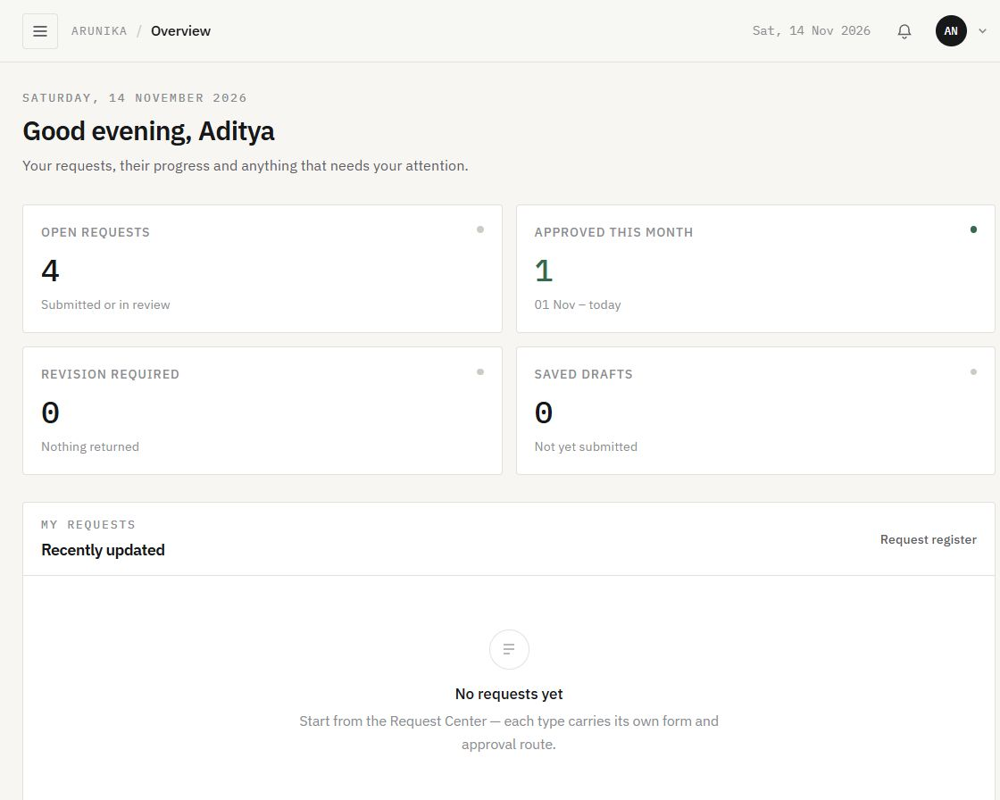
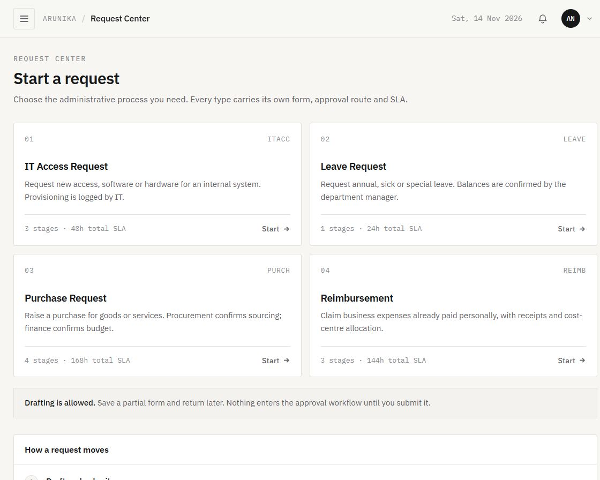
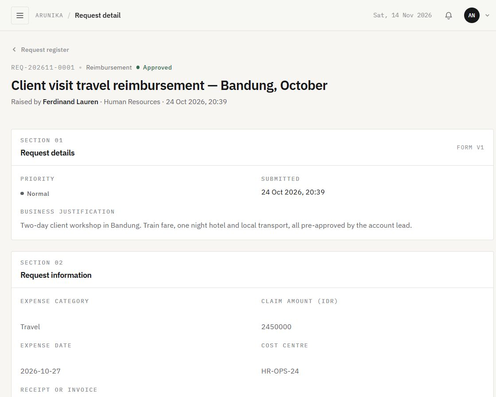
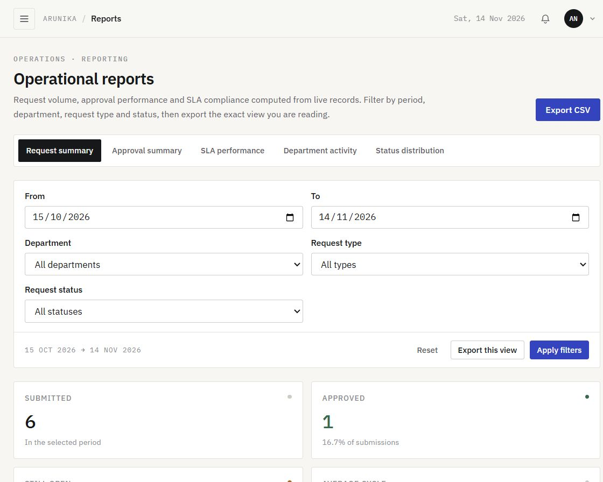
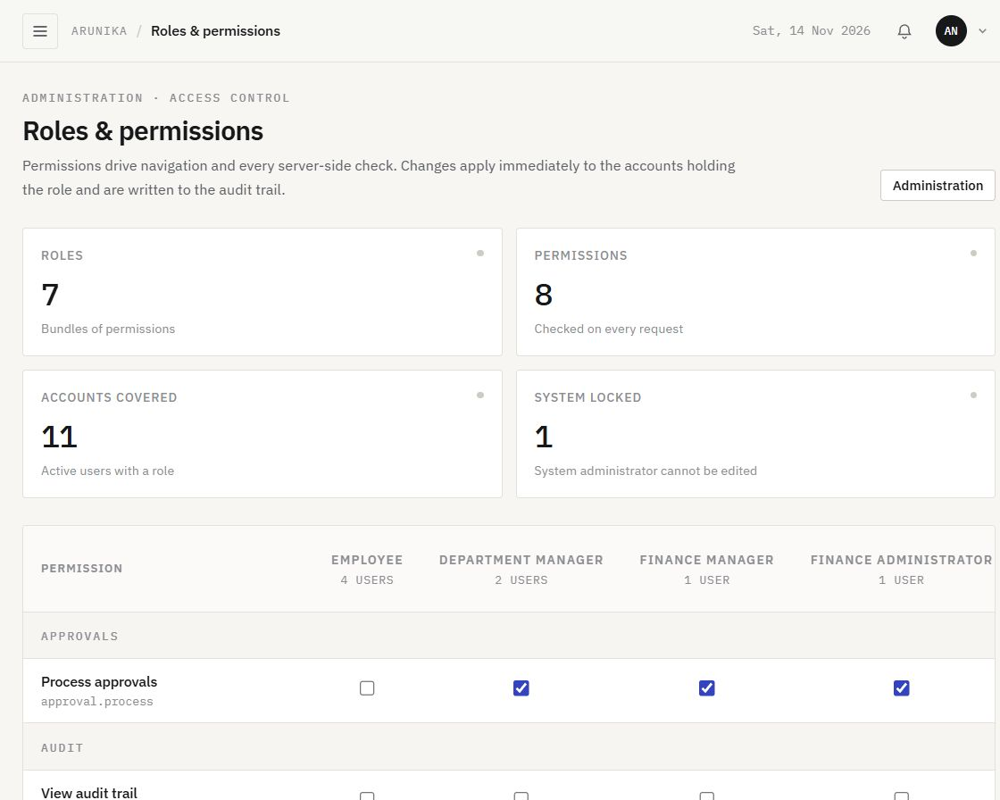
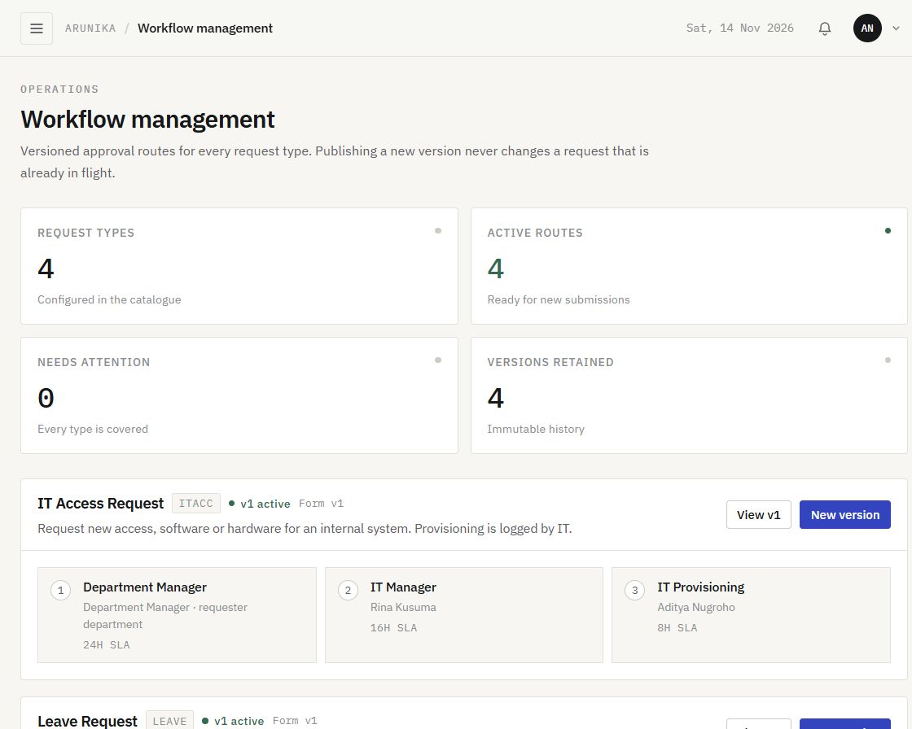

# Arunika Flow — Business Process Automation System

A working business process automation system built with Laravel 12 and Livewire 3 for a fictional industrial company, **PT Arunika Industrial Solutions**. Requests are raised through configurable forms, routed through versioned sequential approval workflows with per-stage deadlines, decided with a full audit trail, and measured in operational reports computed from live data.

> This is a portfolio project. The company, the people and the data are fictional. No external service is integrated, and no deployment is claimed.

---

## 1. Project introduction

Arunika Flow replaces email-and-spreadsheet approvals with a single system of record. Every administrative request — reimbursement, leave, IT access, purchase — has one record, one approval route, one deadline and one history. Routing rules, approver authority and deadlines are configuration, not convention: process administrators change them in the UI, and in-flight requests keep the version they started with.

The project deliberately avoids the usual portfolio shortcuts: no fabricated dashboard figures, no buttons without behaviour, and no business logic in the UI layer. Every number on screen is computed from database records, and every authorisation is enforced server-side.

## 2. Business problem

| Problem | Consequence | How the system answers it |
| --- | --- | --- |
| No single record of a request | Status disputes, lost approvals | One `requests` record with a status that reflects reality |
| Implicit approval authority | Requests stall when someone is away | Approver role + scope encoded per stage, resolved at runtime |
| No accountability | Decisions cannot be evidenced | Append-only audit trail plus per-task decision history |
| No visibility | Management cannot measure throughput | Five live reports with cycle time and SLA compliance |
| Deadlines unenforceable | Slow approvals invisible | Business-hour SLA per stage, reminders and breach recording |

## 3. Project objectives

1. Give every request a single authoritative record with a trustworthy status.
2. Encode approval routes, approvers and deadlines as configurable data.
3. Record every decision and configuration change in an append-only trail.
4. Report on live data rather than maintained spreadsheets.
5. Enforce authorisation on the server so the interface cannot bypass the process.

## 4. Key features

**Requests**
- Schema-driven dynamic forms: text, long text, number, date, dropdown, single choice, multiple choice and file upload, each with required and help text.
- Draft saving, submission with completeness checks, cancellation, and revision handling that resumes at the same stage.
- Attachments validated by extension, MIME type and size, stored privately and served only to the requester and assigned approvers.

**Approval engine**
- Versioned sequential workflows with ordered stages, per-stage SLA hours and three approver scopes (requester's department, any holder of a role, one named person).
- Transactional decisions with a row lock and a conditional update, so a task can never be decided twice.
- Publish-supersede versioning: published routes and routes with history are immutable, and instances pin the version they started with.

**Governance**
- Seven roles and eight permissions, editable through a permission matrix, with the system-administrator column locked and a guard that no change may leave the system unadministrable.
- Last-administrator protection, self-deactivation prevention, and automatic sign-out of deactivated accounts.
- Append-only audit trail with filters for text, action, actor and date range.

**Operations**
- Role-aware dashboard: employee, approver, administrator and management views.
- Five operational reports with shared filters and streamed CSV export (UTF-8 BOM, formula-injection sanitising).
- In-app notifications for assignment, stage advance, completion, rejection, revision, SLA reminders and breaches.
- Scheduled SLA monitor with `--dry-run`, idempotent through claim columns.

## 5. Business workflow

```
draft ──submit──▶ under_review ──approve (not last)──▶ under_review (next stage)
  ▲                    │                                        │
  │                    ├──approve (last stage)──▶ approved ─────┘
  │                    ├──reject────────────────▶ rejected
  └──resubmit──────────┴──request revision─────▶ revision_required
                       └──cancel───────────────▶ cancelled
```

Seeded routes:

| Request type | Route |
| --- | --- |
| Reimbursement | Department Manager (24h) → Finance Manager (48h) → Finance Processing (72h) |
| Leave | Department Manager (24h) |
| IT Access | Department Manager (24h) → IT Manager (16h) → IT Provisioning (8h) |
| Purchase | Department Manager (24h) → Procurement Review (48h) → Finance Manager (48h) |

Deeper detail: [`docs/WORKFLOW_SPECIFICATION.md`](docs/WORKFLOW_SPECIFICATION.md).

## 6. User roles

| Role | Purpose |
| --- | --- |
| Employee | Raise and track their own requests |
| Department Manager | Decide requests raised in their department |
| Finance Manager | Decide financial requests, view reports |
| Finance Administrator | Process approved financial requests, view reports |
| Process Administrator | Configure request types, forms and workflows, view reports |
| System Administrator | Manage accounts, roles, departments, audit trail, reports |
| Management | Company-wide reporting |

Permissions: `request.create`, `request.view.any`, `approval.process`, `workflow.manage`, `user.manage`, `organisation.manage`, `report.view`, `audit.view`.

## 7. Technology stack

| Area | Choice |
| --- | --- |
| Language | PHP 8.3 |
| Framework | Laravel 12 |
| Interactive UI | Livewire 3.8.3 |
| Styling | Tailwind CSS 4 with Vite 6 |
| Typography | IBM Plex Sans and IBM Plex Mono, self-hosted |
| Database | SQLite for development and tests; PostgreSQL 16 intended for production |
| Tests | PHPUnit (Laravel's runner) |

Livewire 3.8.3 was chosen deliberately after reviewing the advisories affecting earlier 3.x releases.

## 8. System architecture

```
routes/ → app/Http (thin controllers) & app/Livewire (components)
        → app/Services (business logic and state transitions)
        → app/Models (Eloquent) → database/
```

- State transitions exist once, inside services, and are reused by controllers, components and commands.
- Authorisation is two-layered: gates for capability and policies for record-level rules, both server-side.
- Every important operation runs in a database transaction; approval decisions additionally lock the row and assert the affected-row count.
- Full detail: [`docs/SYSTEM_ARCHITECTURE.md`](docs/SYSTEM_ARCHITECTURE.md).

## 9. Database overview

Sixteen tables. Organisation and access: `departments`, `users`, `roles`, `permissions`, `role_user`, `permission_role`, `audit_logs`. Requests: `request_types`, `form_templates`, `request_number_sequences`, `requests`, `request_attachments`. Workflow: `workflow_templates`, `workflow_stages`, `workflow_instances`, `approval_tasks`, `approval_histories`, `workflow_events`. Notifications: `notifications`.

Full schema, relationships, indexes and integrity rules: [`docs/DATABASE_DESIGN.md`](docs/DATABASE_DESIGN.md).

## 10. Installation guide

Requirements: PHP 8.2+ with the usual Laravel extensions, Composer, Node.js 18+ and npm.

```bash
git clone https://github.com/FerdinandLauren/Business-Process-Automation-System.git
cd Business-Process-Automation-System

composer install
npm install

cp .env.example .env
php artisan key:generate

php artisan migrate --seed
php artisan bpa:sla-monitor   # records the demo SLA breach; safe to re-run
npm run build

php artisan serve
```

Open `http://127.0.0.1:8000` and sign in with a demo account.

## 11. Environment configuration

The defaults in `.env.example` are sufficient for local development (SQLite, file cache, sync queue, log mailer). Relevant project settings:

```dotenv
APP_TIMEZONE=Asia/Jakarta
BPA_TIMEZONE=Asia/Jakarta
BPA_ATTACHMENT_DISK=local
BPA_ATTACHMENT_MAX_KB=5120
BPA_SLA_REMINDER_HOURS=4
```

The SLA business calendar (working days and hours) lives in `config/bpa.php`.

No credentials are committed to the repository.

## 12. Database migration

```bash
php artisan migrate            # apply
php artisan migrate:fresh --seed   # rebuild with demo data
```

The seeder creates seven departments, eleven users, four request types with published forms, four published workflows and six requests covering approved, rejected, revision-required, pending-at-first-stage and overdue-at-second-stage paths. The overdue task has no breach recorded until the monitor runs, so run it once after seeding to reproduce the demo state (one breach, two notifications, one audit entry):

```bash
php artisan bpa:sla-monitor --dry-run   # show what would happen
php artisan bpa:sla-monitor             # send reminders, record breaches
```

Running it a second time changes nothing — claiming is idempotent.

## 13. Demo accounts

All demo accounts use the password `password`.

| Email | Role | What to look at |
| --- | --- | --- |
| `ferdinand@arunika.test` | Employee | Request centre, drafts, revision request |
| `andi@arunika.test` | Department Manager | Approval inbox with a pending leave request |
| `rina@arunika.test` | Department Manager (IT) | Overdue IT access task with a recorded breach |
| `budi@arunika.test` | Finance Manager | Financial approvals, reports |
| `sari@arunika.test` | Finance Administrator | Final processing stage |
| `dewi@arunika.test` | Process Administrator | Workflows, request types, forms, reports |
| `admin@arunika.test` | System Administrator | Users, roles, departments, audit trail |
| `hendra@arunika.test` | Management | Company-wide reports |
| `nadia@`, `yusuf@`, `maya@arunika.test` | Employees | Additional requesters |

## 14. Testing instructions

```bash
php artisan test                       # whole suite
php artisan test --testsuite=Unit      # business-hour maths, form validation
php artisan test --testsuite=Feature   # HTTP, authorisation, workflow, reports
```

Latest result: **103 tests, 339 assertions, all passing** (~119s), running against an in-memory SQLite database so the demo data is never touched. What is and is not covered is documented in [`docs/TESTING_REPORT.md`](docs/TESTING_REPORT.md).

## 15. Screenshots

| Overview | Request centre |
| --- | --- |
|  |  |

| Request detail | Operational reports |
| --- | --- |
|  |  |

| Roles and permissions | Workflow management |
| --- | --- |
|  |  |

## 16. Known limitations

- **SQLite only.** The application was developed and tested against SQLite. Migrations avoid engine-specific features and should run on PostgreSQL 16, but no PostgreSQL run was performed.
- **No escalation.** An SLA breach is recorded and notified but the task is not reassigned.
- **Sequential approvals only.** No parallel, conditional or dynamic branching.
- **In-app notifications only.** No email, chat or webhook delivery.
- **One business calendar.** Monday–Friday, 08:00–17:00, with no public-holiday awareness.
- **No queue worker required.** Notifications are written synchronously in the same transaction.
- **Concurrency** is guarded by a conditional update; real parallel HTTP requests were not simulated in tests.
- **Attachments** are stored on the local disk; no cloud storage or virus scanning.
- **No SSO, multi-tenancy, mobile app or external payment/procurement integration.**

## 17. Future development

1. Escalation rules for breached tasks (notify a second approver, then reassign).
2. Parallel and conditional approval branches with join semantics.
3. A public holiday calendar and per-department working hours.
4. Email and chat delivery through queued notifications.
5. Scheduled report delivery and a saved-filter feature.
6. PostgreSQL deployment with a CI pipeline running the suite against both engines.
7. Multi-tenant organisation scoping.
8. File scanning and cloud storage for attachments.
9. A full-text search index across requests and the audit trail.

---

## Documentation

| Document | Contents |
| --- | --- |
| [`PROJECT.md`](PROJECT.md) | Original specification and acceptance criteria |
| [`docs/IMPLEMENTATION_PLAN.md`](docs/IMPLEMENTATION_PLAN.md) | Milestones, architecture decisions and risks |
| [`docs/BUSINESS_ANALYSIS.md`](docs/BUSINESS_ANALYSIS.md) | Problem, actors, scope, business rules, traceability |
| [`docs/SYSTEM_ARCHITECTURE.md`](docs/SYSTEM_ARCHITECTURE.md) | Stack, layering, services, lifecycle, security, reporting |
| [`docs/DATABASE_DESIGN.md`](docs/DATABASE_DESIGN.md) | Tables, relationships, indexes, integrity, portability |
| [`docs/WORKFLOW_SPECIFICATION.md`](docs/WORKFLOW_SPECIFICATION.md) | Stages, approver resolution, transitions, SLA, edge cases |
| [`docs/TESTING_REPORT.md`](docs/TESTING_REPORT.md) | Test command, results, coverage, defects fixed, gaps |
| [`docs/USER_GUIDE.md`](docs/USER_GUIDE.md) | How each role uses the system |
| [`docs/CHANGELOG.md`](docs/CHANGELOG.md) | Milestone history |

## License

Released under the MIT licence. The company, users and data are fictional and exist only to demonstrate the system.
